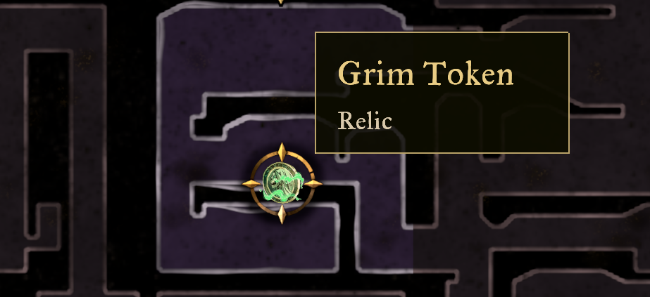
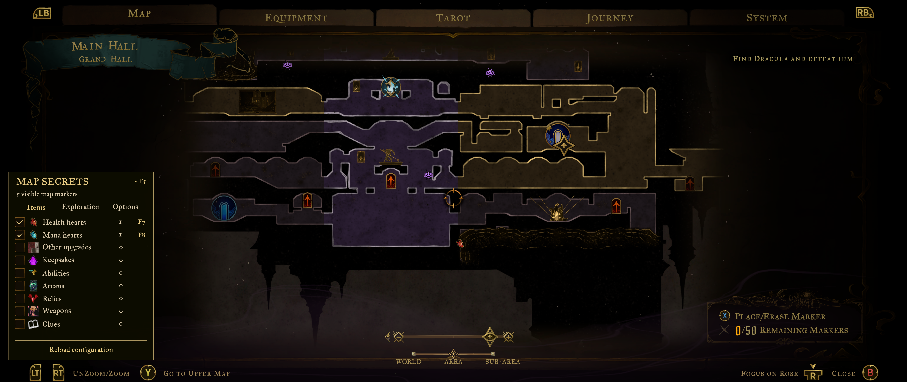
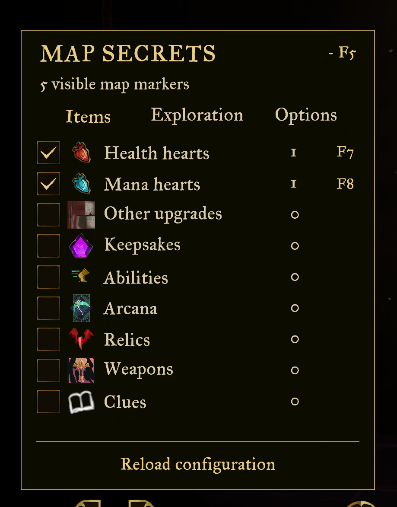

# Screenshots

Captured in game by Oliver Atkinson. Screenshots show game artwork; that artwork belongs to its respective owners.

## Marker hover label

Hovering the Grim Token marker shows its item name and relic category using the game’s font.

## Area map

Native collectible and hidden-passage icons alongside the game’s map, with the filter panel open.

## Filter menu

These map/menu captures show the earlier 0.1.1 layout. In 0.1.2, “Other upgrades” becomes “Attack / defence books”, and experience sources have a separate toggle that starts disabled.

